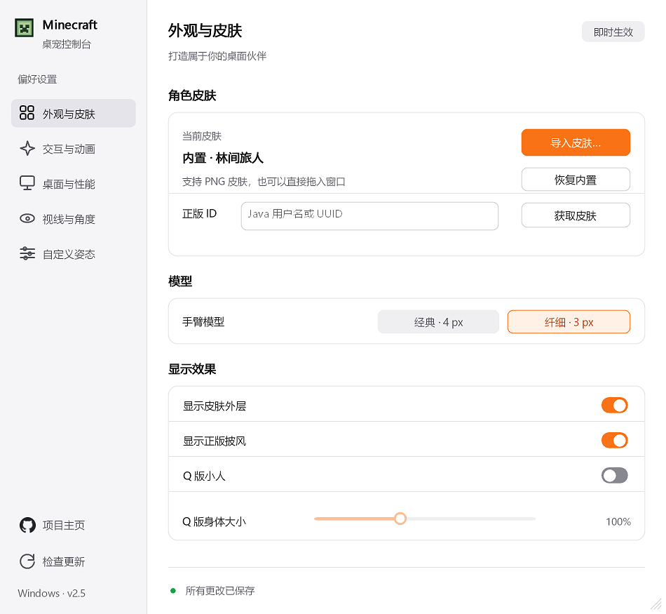
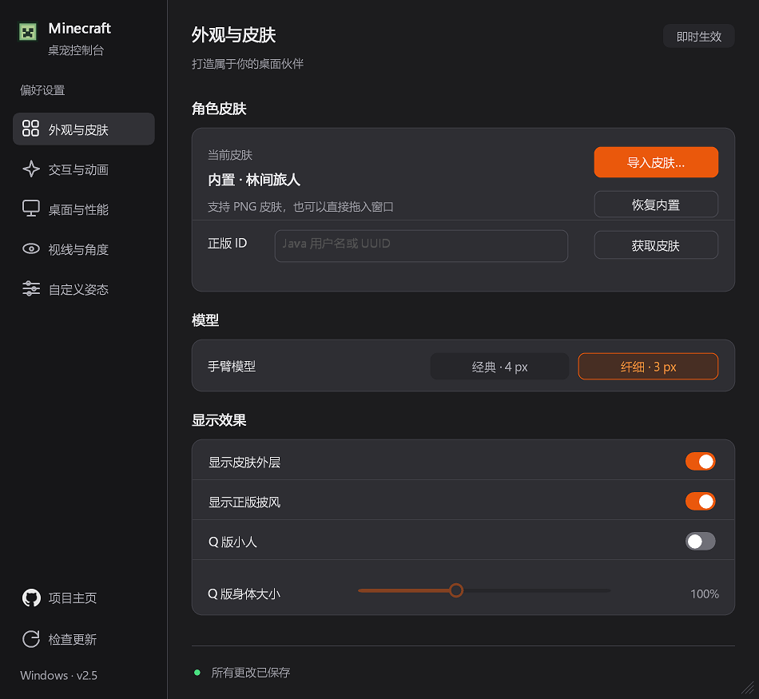
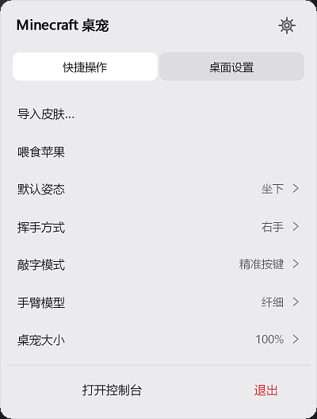
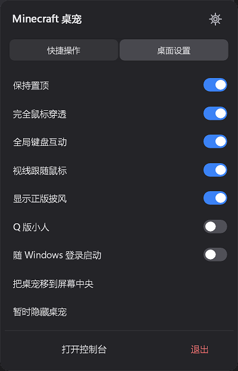
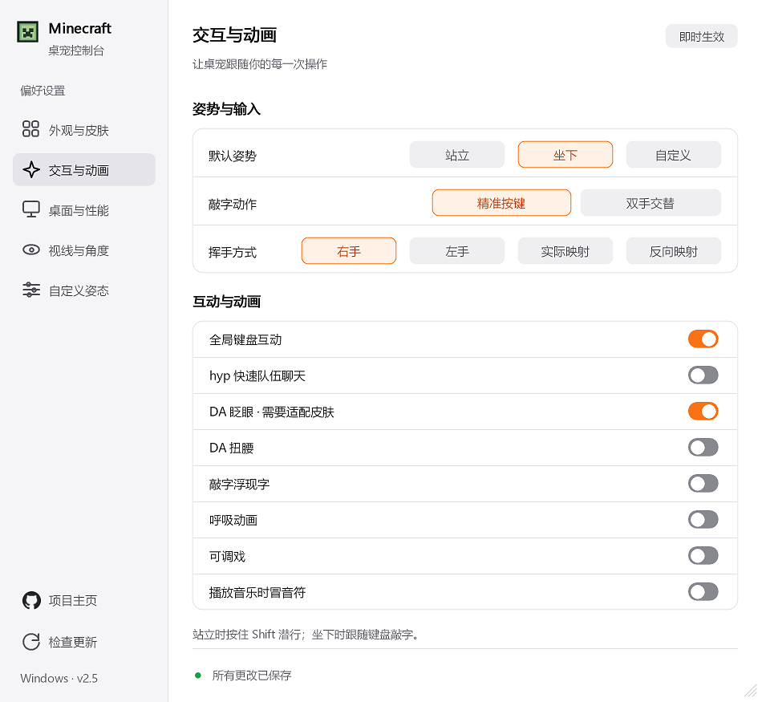
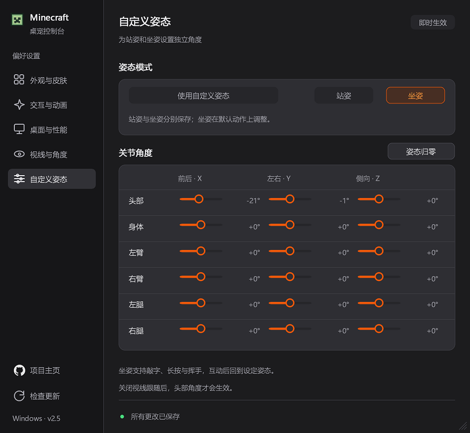

# Minecraft 桌宠 · Windows UI 增强版

让 Minecraft 风格的小人陪伴你的桌面，同时拥有更清晰、流畅的控制台与托盘菜单。

本仓库是 [DLmember/Minecraft-Desktop-Pet](https://github.com/DLmember/Minecraft-Desktop-Pet) 的 Fork。`windows-ui-v4` 分支基于上游 v2.5 系列，集中优化 **Windows 界面与交互体验**，保留原有桌宠功能。界面参考 [CC Switch](https://github.com/farion1231/cc-switch)，使用原生 Rust + Win32 实现。

**Windows 10 / 11 x64 · 便携运行 · 原生 Win32 · MIT**

## 下载与运行

- **[下载 Windows 完整运行包（推荐）](https://github.com/Kevae12138/Minecraft-Desktop-Pet/releases/download/ui-v4/Minecraft-Desktop-Pet-UI-v4-Windows-x64.zip)**：包含 EXE、使用说明与第三方许可证。
- **[直接下载 EXE](https://github.com/Kevae12138/Minecraft-Desktop-Pet/releases/download/ui-v4/Minecraft-Desktop-Pet-UI-v4-Windows-x64.exe)**：无需额外运行环境。
- [查看 UI v4 发布说明](https://github.com/Kevae12138/Minecraft-Desktop-Pet/releases/tag/ui-v4) · [下载本版本源码 ZIP](https://github.com/Kevae12138/Minecraft-Desktop-Pet/archive/refs/tags/ui-v4.zip)

先从系统托盘退出旧版，再解压并运行 `Minecraft桌宠.exe`。双击托盘图标打开控制台，右键打开快捷菜单。首次运行默认开启鼠标穿透；如需拖动桌宠，请先关闭“完全鼠标穿透”。

本分支的 EXE 基础版本号仍为 **2.5.0**，界面修订号为 **UI v4**。软件内“项目主页”和“检查更新”仍沿用上游入口；本分支的界面版本请从上面的发布页获取。

## UI 展示

### 浅色控制台



### 深色控制台



### 托盘快捷菜单

<p>
  
  
</p>

### 交互与姿态设置

<p>
  
  
</p>

### Q 版身体比例调节


控制台展示图由程序自身绘制路径导出；托盘和滑块图来自隔离测试中的实际屏幕截图，未使用概念稿。

## 本分支改进

| 项目 | 当前效果 |
| --- | --- |
| 控制台布局 | 侧栏导航、分组卡片、橙色操作按钮，提供深浅主题 |
| 五个设置页 | 外观与皮肤、交互与动画、桌面与性能、视线与角度、自定义姿态 |
| 窗口尺寸 | 默认及最小客户区 **760×700 逻辑像素**，宽高可独立调大，支持最大化 |
| 清晰度 | 自绘内容以三倍分辨率绘制后高质量缩采样，保留合适的文字大小 |
| 系统字体 | 控制台和托盘读取 Windows 当前系统界面字体，并响应设置变化 |
| 导航切换 | 侧栏导航支持快速切换设置页面 |
| 托盘菜单 | 快捷操作 / 桌面设置、分组子菜单、键盘导航、Esc 返回和外部点击关闭 |
| 滑块 | 支持调节 Q 版身体比例，数值与百分比同步更新 |

调整控制台大小不会改变桌宠本体大小。按钮和开关保留短时反馈；关闭 Windows 系统动画后立即切换。

## 保留的桌宠功能

- 导入 PNG 皮肤、通过正版 ID 获取皮肤与披风，支持经典和纤细手臂。
- 站立、坐下、自定义姿态、Q 版身体比例、视线跟随与角度调整。
- 键盘互动、挥手方式、喂食苹果、呼吸、调戏、打字浮现字符和音乐音符。
- 置顶、鼠标穿透、大小与帧率调整、开机自启。

上游特定皮肤动画仍需要对应皮肤资源。本次界面改动仅针对 Windows；仓库保留原有 macOS 源码，本次发布不提供新的 macOS 安装包。

## 从源码构建（Windows）

需要 Rust `stable-x86_64-pc-windows-gnu` 及 x86_64 UCRT 版 [LLVM-MinGW](https://github.com/mstorsjo/llvm-mingw/releases)，其中应包含 `clang++`、`windres` 与 `x86_64-w64-mingw32-gcc`。

```powershell
git clone --branch windows-ui-v4 https://github.com/Kevae12138/Minecraft-Desktop-Pet.git
cd Minecraft-Desktop-Pet
rustup toolchain install stable-x86_64-pc-windows-gnu
powershell -NoProfile -ExecutionPolicy Bypass -File scripts/build.ps1 -ToolchainBin D:\Software\llvm-mingw\bin
```

请将最后一行路径替换成自己的 LLVM-MinGW `bin` 路径。默认产物为 `native/target/release/minecraft-pet.exe`。首次构建需要下载 `Cargo.lock` 锁定的依赖。

```powershell
# 回归测试
powershell -NoProfile -ExecutionPolicy Bypass -File scripts/build.ps1 -Action test -ToolchainBin D:\Software\llvm-mingw\bin
```

源代码主要位于 `native/src`，预设位于 `native/default-settings.json`，内置皮肤与图标位于 `assets`。

## 验证记录

- Windows 二进制测试：**81 通过、1 项原有忽略、0 失败**。
- 深浅主题、五页布局、最小尺寸、独立宽高调整、最大化与控件重叠检查通过。
- 100 次控制台导航、80 次托盘切页以及二级菜单操作回归通过。
- 滑块支持鼠标拖动和键盘调节，显示效果检查通过。
- 系统字体读取、DPI 缩放和字体设置通知检查通过。

详见 [UI v4 中文说明](docs/UI-v4.zh-CN.md) 与 [界面自检报告](docs/verification/ui-self-test.json)。

## 来源与致谢

- 原项目：[DLmember/Minecraft-Desktop-Pet](https://github.com/DLmember/Minecraft-Desktop-Pet)，感谢原作者及贡献者。
- 上游 Q 版模型等功能包含 [zsyghxf 的贡献](https://github.com/DLmember/Minecraft-Desktop-Pet/pull/5)，具体历史见 [CHANGELOG.md](CHANGELOG.md)。
- 界面设计参考：[farion1231/cc-switch](https://github.com/farion1231/cc-switch)，相关 MIT 归属保留在 [THIRD_PARTY_NOTICES.md](THIRD_PARTY_NOTICES.md)。

应用代码遵循 [MIT License](LICENSE)。依赖许可证位于 `native/licenses`；运行包附有相应许可证。Windows 字体由系统提供，不分发字体文件。

本项目为独立粉丝作品，与 Mojang Studios、Microsoft 或 CC Switch 无隶属、赞助或官方合作关系。Minecraft 名称、商标和相关游戏资源归各自权利人所有。
